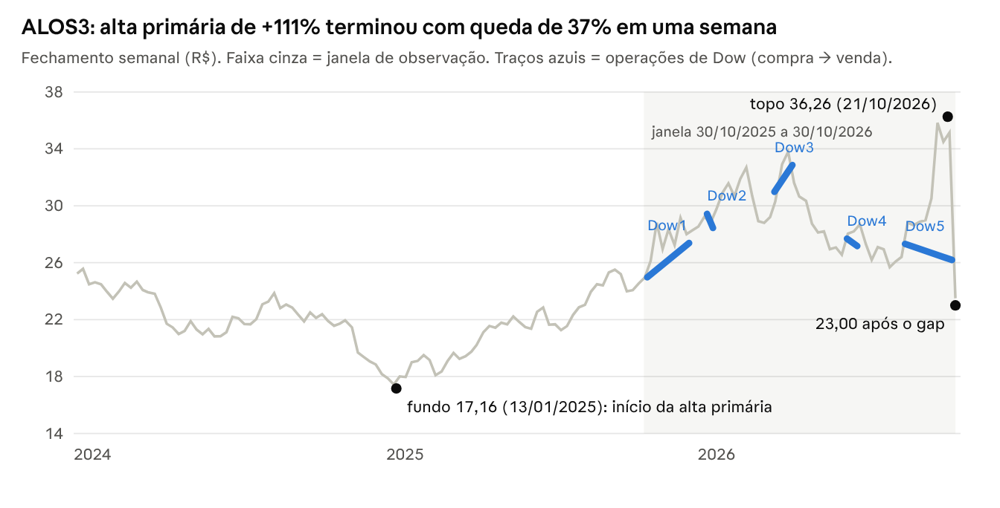

# Relatório ALOS3 — Análise Técnica (30/10/2025 a 30/10/2026)

26/11/2026 · Ana Beatriz Laurentino

Sala de Ações UFPB · Programa de Trainee 2026 · Mentoria de Análise Técnica · Prof. Dr. Sinézio Fernandes Maia. Ativo: ALOS3 (Allos). Janela de observação: 30/10/2025 a 30/10/2026.

## 1. Tendências: primária, secundária e terciária

**Resumo:** a ALOS3 estava numa **tendência primária de alta** desde jan/2025 (fundo de R$ 17,16 em 13/01/2025) até a máxima de **R$ 36,26 em 21/10/2026** (+111%). Na última semana da janela, um gap de baixa de −25% em 26/10/2026 levou a ação a R$ 23,00 em 30/10/2026, o primeiro sinal de que a tendência primária pode ter virado.

| Grau | Período | De → Até (R$) | Variação | Leitura |
| --- | --- | --- | --- | --- |
| **Primária** (\~2 anos) | jan/2024 → jan/2025 | 25,75 → 17,16 | −33% | Baixa: topos e fundos descendentes (contexto antes da janela) |
| **Primária** | 13/01/2025 → 21/10/2026 | 17,16 → 36,26 | +111% | Alta: fundos cada vez mais altos durante quase 2 anos |
| Secundária (\~3 meses) | 15/10/2025 → 17/04/2026 | 23,44 → 34,17 | +46% | Alta dentro da primária de alta |
| Secundária | 17/04/2026 → 18/08/2026 | 34,17 → 25,20 | −26% | Correção: devolveu \~84% da alta secundária anterior |
| Secundária | 18/08/2026 → 21/10/2026 | 25,20 → 36,26 | +44% | Retomada da alta, nova máxima |
| Secundária | 21/10/2026 → 30/10/2026 | 36,26 → 23,00 | −37% | Queda brusca (gap de 26/10) |
| Terciária (\~3 semanas) | 30/10 → 04/12/2025 | 24,29 → 29,77 | +23% | Perna de alta rápida |
| Terciária | 04/12 → 22/12/2025 | 29,77 → 27,21 | −9% | Pequena correção |
| Terciária | 26/02 → 20/03/2026 | 32,88 → 28,58 | −13% | Correção dentro da alta |
| Terciária | 20/03 → 17/04/2026 | 28,58 → 34,17 | +20% | Perna de alta |
| Terciária | 29/09 → 21/10/2026 | 28,37 → 36,26 | +28% | Arrancada final (euforia) |

**Como ler:** a primária é a maré (dura anos), a secundária é a onda (semanas a meses, corrige de 1/3 a 2/3 da primária) e a terciária é a marola (dias a poucas semanas). A correção de abr–ago/2026 passou de 2/3 da alta anterior, o que pela Teoria de Dow já acendia um alerta, mas o fundo de 25,20 ficou acima do início da alta (17,16) e a ação voltou a subir.

## 2. Fases das tendências

Na janela, a ALOS3 passou pelas três fases da alta e, no fim, pulou direto para o pânico.

| Fase | Período | Preço (R$) | O que se vê no gráfico |
| --- | --- | --- | --- |
| Acumulação | jan–mar/2025 e out/2025 | 17,2–19,9 e 23,4–25,0 | Preço de lado depois da queda de 2024; os "compradores pacientes" montam posição sem pressa |
| Alta sensível | nov/2025 → abr/2026 | 24,3 → 34,2 | Topos e fundos ascendentes; rompimento de 13/11/2025 com 13,5 mi de volume. **É a fase para entrar** |
| Euforia | set → 21/10/2026 | 25,2 → 36,3 | +44% em 2 meses; gap de alta em 05/10/2026 com 22,4 mi de volume (3,7× a média) |
| Distribuição | 09/10 → 23/10/2026 (e mar–abr/2026, menor) | 33,8–36,3 | Preço trava no topo com volume alto: quem comprou barato vende para quem chegou tarde |
| Baixa sensível | mai → ago/2026 | 34,2 → 25,2 | Queda lenta, sem desespero, volume baixo (correção secundária, não virada) |
| Pânico | 26 → 30/10/2026 | 35,1 → 23,0 | Gap de −25% na abertura de 26/10, volume de 27,4 mi (4,6× a média) |

O pânico de outubro/2026 veio sem uma baixa sensível antes dele. Por isso a pergunta para a aula é: foi uma notícia (fato relevante) ou o início de uma tendência primária de baixa? Vale conferir os fatos relevantes da Allos nessa data. Depois da janela a ação voltou para R$ 26,23 (25/11/2026), um pouco acima do fundo de ago/2026 (25,20), então a tendência primária ainda está indefinida.

## 3. Volume x Tendência

O volume confirmou as altas: em todas as pernas de alta, os dias de alta tiveram mais volume que os dias de queda. Média da janela: **6,0 milhões de ações/dia**.

| Movimento | Período | Volume médio nos dias de alta | Volume médio nos dias de queda | Leitura |
| --- | --- | --- | --- | --- |
| Alta | 30/10 → 04/12/2025 | 5,3 mi | 3,8 mi | Volume cresce na alta: **confirma** |
| Correção | 04/12 → 22/12/2025 | 6,7 mi | 14,4 mi | Venda forte (38 mi em 05/12), mas o fundo segurou acima de 27 |
| Alta | 22/12/2025 → 26/02/2026 | 5,5 mi | 4,9 mi | Confirma, com menos força |
| Alta | 20/03 → 17/04/2026 | 7,0 mi | 5,1 mi | Confirma |
| Correção | 17/04 → 18/08/2026 | 4,8 mi | 4,8 mi | Volume **decrescente** (3 a 4 mi em jul–ago): queda sem força, sinal de que podia reverter |
| Euforia | 18/08 → 21/10/2026 | 7,5 mi | 5,4 mi | Volume crescente: continuação da alta |
| Pânico | 21/10 → 30/10/2026 | 7,3 mi | 16,3 mi | Volume explode na queda: **pressa para vender** |

**Regra da aula aplicada:** volume crescente acompanhou a continuação da alta (nov/2025, abr/2026, set–out/2026). Volume decrescente na correção de mai–ago/2026 indicou que a queda perdia força, e a alta voltou em setembro. Volume é o "raio X": mostra quem está com pressa, compradores ou vendedores.

## 4. Congestões e ângulo

Congestão é quando o preço anda de lado numa faixa estreita por algumas semanas. Ela é **acumulação** se rompe para cima e **distribuição** se rompe para baixo; a direção do rompimento é que confirma.

| Congestão | Faixa (R$) | Duração | Rompimento | Tipo |
| --- | --- | --- | --- | --- |
| out/2025 | 23,4–25,0 | \~3 semanas | Para cima em 05/11/2025 | Acumulação |
| dez/2025–jan/2026 | 27,2–29,8 | \~6 semanas | Para cima em 27/01/2026 | Acumulação (continuação da alta) |
| mar/2026 | 28,6–30,6 | \~3 semanas | Para cima em 08/04/2026 | Acumulação |
| jun–ago/2026 | 25,2–28,8 | \~10 semanas | Para cima em 02/09/2026, volume 7,9 mi | Acumulação (fim da correção) |
| 09–23/10/2026 | 33,8–36,3 | \~2 semanas | Para baixo em 26/10/2026, com gap | **Distribuição** |

**Ângulo (intensidade emocional).** O ângulo depende da escala do gráfico, então usei a velocidade da tendência (% por semana) para comparar:

| Tendência | Velocidade | Ângulo aproximado | Leitura |
| --- | --- | --- | --- |
| Primária de alta (jan/2025 → abr/2026) | +1,5%/semana | \~30–45° | Saudável e sustentável |
| Baixa sensível (abr → ago/2026) | −1,5%/semana | \~30° | Correção calma |
| Alta de nov/2025 | +4,5%/semana | \~45–60° | Forte, mas ainda saudável |
| Euforia (29/09 → 21/10/2026) | +8,9%/semana | **> 60°** | Insustentável: subida "em pé" costuma terminar em queda brusca |

A lição: o ângulo acima de 60° em outubro/2026 já avisava que a euforia não duraria. Uma semana depois veio o pânico.

## 5. Estratégia operacional: boleta

Com 1 ação por operação, a **Teoria de Dow (+1,18%) ganhou do Buy and Hold (−4,97%)** ficando comprada só 144 dos 365 dias; a Teórica (+49,28%) é o teto impossível de alcançar na prática.

| Estratégia | Compra | Preço | Venda | Preço | Dias | Lucro R$ | % |
| --- | --- | --- | --- | --- | --- | --- | --- |
| **Buy and Hold** | 30/10/2025 | 24,73 | 30/10/2026 | 23,50 | 365 | −1,23 | **−4,97%** |
| **Teórica** | 30/10/2025 | 24,29 | 21/10/2026 | 36,26 | 356 | +11,97 | **+49,28%** |
| Dow1 | 03/11/2025 | 24,97 | 22/12/2025 | 27,38 | 49 | +2,41 | +9,65% |
| Dow2 | 12/01/2026 | 29,43 | 19/01/2026 | 28,44 | 7 | −0,99 | −3,36% |
| Dow3 | 01/04/2026 | 30,98 | 22/04/2026 | 32,86 | 21 | +1,88 | +6,07% |
| Dow4 | 25/06/2026 | 27,69 | 07/07/2026 | 27,17 | 12 | −0,52 | −1,88% |
| Dow5 | 01/09/2026 | 27,32 | 26/10/2026 | 26,19 | 55 | −1,13 | −4,14% |
| **Pay off Dow** |  | 140,39 |  | 142,04 | 144 | **+1,65** | **+1,18%** |

- **Buy and Hold:** compra no fechamento do primeiro dia da janela e venda no fechamento do último. A Allos pagou dividendos todo mês (cerca de R$ 3,51 no período, calculado pelo fechamento ajustado do Yahoo); com eles, o retorno total do B&H seria de **\~+9,2%**. A boleta usa só o preço, como pede o exercício.
- **Teórica:** compra na menor mínima antes do topo (24,29 em 30/10/2025) e venda na maior máxima (36,26 em 21/10/2026). Pelo fechamento de 30/10/2025 (24,73), daria +46,62%.
- **Pay off** = lucro somado das 5 operações ÷ dinheiro investido somado = 1,65 ÷ 140,39 = 1,18%.

## 6. Teoria de Dow para iniciantes

**A ideia em uma frase:** uma ação está em alta enquanto fizer **topos e fundos cada vez mais altos**, como uma escada subindo. Compramos quando a escada se confirma e vendemos quando ela quebra.

**Vocabulário:**

- **Topo:** um pico. Aqui, um dia cuja máxima é maior que a dos 2 dias antes e dos 2 dias depois.
- **Fundo:** um vale. Um dia cuja mínima é menor que a dos 2 dias antes e dos 2 dias depois.
- **Fundo ascendente:** um fundo mais alto que o fundo anterior. Mostra que os compradores entraram antes de o preço cair tanto quanto da última vez.

**A regra que usamos (sempre a mesma, para dar para conferir):**

1. **Esperar um fundo ascendente.** Sem ele, não há sinal de alta.
2. **Comprar quando o preço fecha acima do último topo.** O fechamento acima do topo confirma a escada: topo mais alto + fundo mais alto = tendência de alta.
3. **Vender quando o preço fecha abaixo do último fundo.** Se o preço perde o último degrau, a escada quebrou. A venda protege o lucro (ou limita a perda).
4. **Enquanto a escada sobe, o ponto de venda sobe junto:** a cada novo fundo mais alto, o "stop" passa a ser esse fundo.

Usamos o **preço de fechamento** para decidir, como Charles Dow fazia. Uma limitação: um topo ou fundo só é confirmado 2 dias depois, por isso a Dow sempre entra um pouco depois do fundo e sai um pouco depois do topo. Ela nunca pega o movimento inteiro.

**Operação por operação:**

| Op. | Por que comprou | Por que vendeu | Resultado |
| --- | --- | --- | --- |
| Dow1 | Fundo de 30/10 (24,29) mais alto que o de 22/10 (24,04). Em 03/11 fechou a 24,97, acima do topo de 27/10 (24,96) | Em 22/12 fechou a 27,38, abaixo do fundo de 17/12 (27,42) | +9,65%: pegou boa parte da alta de nov/2025 |
| Dow2 | Fundo de 08/01 (28,64) acima do de 22/12 (27,21). Em 12/01 fechou a 29,43, acima do topo de 23/12 (28,41) | Em 19/01 fechou a 28,44, abaixo do fundo de 13/01 (28,49) | −3,36%: **falso rompimento**, a ação estava de lado |
| Dow3 | Fundo de 30/03 (28,70) acima do de 20/03 (28,58). Em 01/04 fechou a 30,98, acima do topo de 25/03 (30,65) | Em 22/04 fechou a 32,86, abaixo do fundo de 16/04 (33,05) | +6,07%: saiu perto do topo de 34,17 |
| Dow4 | Fundo de 23/06 (26,44) acima do de 16/06 (26,17). Em 25/06 fechou a 27,69, acima do topo de 22/06 (27,16) | Em 07/07 fechou a 27,17, abaixo do fundo de 30/06 (27,50) | −1,88%: outro falso sinal na congestão |
| Dow5 | Fundo de 28/08 (25,93) acima do de 18/08 (25,20). Em 01/09 fechou a 27,32, acima do topo de 26/08 (26,80) | O stop subiu até o fundo de 14/10 (33,76), com lucro de \~+24%. Mas em 26/10 a ação **abriu em gap** a 24,01, abaixo do stop. Venda no fechamento: 26,19 | −4,14%: o gap "pulou" o stop |

**O que aprender:**

- A Dow funciona bem em tendência (Dow1, Dow3) e erra em mercado de lado (Dow2, Dow4). Essas perdas pequenas são o "custo" de estar posicionado quando a tendência aparece.
- A Dow corta perdas cedo: as operações perdedoras perderam no máximo 3,4% (sem contar o gap).
- Nenhuma regra protege contra gap. Sem o gap de 26/10, a Dow5 teria vendido perto de 33,76 (+24%) e o pay off ficaria em cerca de +6,5%.

## 7. Gráfico

O gráfico mostra a baixa primária de 2024, a alta primária a partir de jan/2025 e onde cada operação de Dow entrou e saiu. No TradingView, use o gráfico diário da ALOS3 para conferir os topos e fundos citados na seção 6.

## 8. Conclusão

- A ALOS3 viveu uma **tendência primária de alta** (jan/2025 → out/2026, +111%) que terminou com euforia (ângulo > 60°, volume 3,7× a média) e um pânico de −37% em uma semana.
- O volume confirmou as altas e secou na correção de mai–ago/2026, avisando que a queda era secundária.
- Na boleta: **Teórica +49,28% > Dow +1,18% > Buy and Hold −4,97%**. A Dow ganhou do B&H ficando posicionada só 39% do tempo, mas perdeu nos períodos de lado e no gap final.

**Fontes e observações:** cotações diárias da ALOS3.SA no [Yahoo Finance](https://finance.yahoo.com/quote/ALOS3.SA/history/), fechamento sem ajuste de proventos (conferem com as anotações da aula: 24,73, 36,26 e 23,50; a mínima de 30/10/2026 aparece como 23,00 no Yahoo e 22,99 nas anotações). Se algum preço diferir em centavos no TradingView, vale o do TradingView. A planilha da boleta (com fórmulas) e os dados estão nesta pasta: [exercicio-03-boletas-alos3-tims3.xlsx](exercicio-03-boletas-alos3-tims3.xlsx) e [dados/](dados/).
