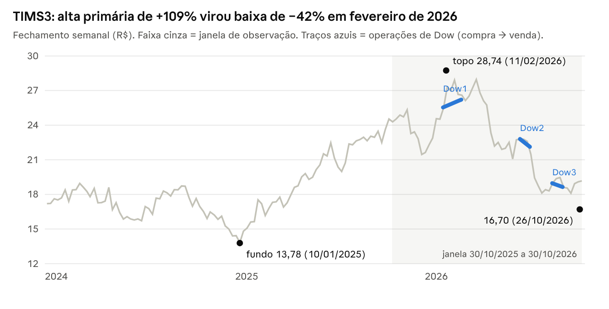

# Relatório TIMS3 — Análise Técnica (30/10/2025 a 30/10/2026)

26/11/2026 · Ana Beatriz Laurentino

Sala de Ações UFPB · Programa de Trainee 2026 · Mentoria de Análise Técnica · Prof. Dr. Sinézio Fernandes Maia. Ativo: TIMS3 (TIM). Janela de observação: 30/10/2025 a 30/10/2026.

## 1. Tendências: primária, secundária e terciária

**Resumo:** a TIMS3 fez uma **tendência primária de alta** de jan/2025 a fev/2026 (R$ 13,78 → R$ 28,74, +109%) e **virou para baixa** a partir da máxima de **11/02/2026**, caindo até R$ 16,70 em 26/10/2026 (−42%). A janela de observação pega o fim da alta e quase toda a baixa.

| Grau | Período | De → Até (R$) | Variação | Leitura |
| --- | --- | --- | --- | --- |
| **Primária** (\~2 anos) | jan/2024 → 10/01/2025 | 17,73 → 13,78 | −22% | Baixa (contexto antes da janela) |
| **Primária** | 10/01/2025 → 11/02/2026 | 13,78 → 28,74 | +109% | Alta: topos e fundos ascendentes por 13 meses |
| **Primária** | 11/02/2026 → 26/10/2026 | 28,74 → 16,70 | −42% | Baixa: topos e fundos descendentes |
| Secundária (\~3 meses) | 30/10 → 26/11/2025 | 24,98 → 25,48 | +2% | Lateral no topo da alta de 2025 |
| Secundária | 26/11 → 26/12/2025 | 25,48 → 21,28 | −16% | Correção (inclui \~R$ 0,91 de proventos descontados em 22–23/12) |
| Secundária | 26/12/2025 → 11/02/2026 | 21,28 → 28,74 | +35% | Última perna da alta primária |
| Secundária | 11/02 → 22/04/2026 | 28,74 → 25,65 | −11% | Lateral com viés de baixa |
| Secundária | 22/04 → 19/05/2026 | 25,65 → 21,88 | −15% | Queda que confirma a baixa |
| Secundária | 19/05 → 15/07/2026 | 21,88 → 23,17 | +6% | Repique (correção de alta dentro da baixa) |
| Secundária | 27/07 → 14/08/2026 | 21,50 → 17,85 | −17% | Queda forte |
| Secundária | 14/08 → 30/10/2026 | 17,85 → 19,17 | +7% | Lateral no fundo, com furo a 16,70 em 26/10 |
| Terciária (\~3 semanas) | 15/01 → 11/02/2026 | 22,45 → 28,74 | +28% | Arrancada final da alta |
| Terciária | 05 → 07/05/2026 | 26,88 → 23,03 | −14% | Queda em 2 dias, volume 13 mi/dia |
| Terciária | 26 → 30/10/2026 | 16,70 → 19,17 | +15% | Reação rápida depois do furo |

**Como ler:** a primária é a maré, a secundária é a onda e a terciária é a marola. A virada da primária ficou confirmada pela Teoria de Dow quando o preço fez um topo mais baixo (28,27 em 10/04/2026, abaixo de 28,74) e depois perdeu o fundo anterior (25,55, perdido em 28/04/2026).

## 2. Fases das tendências

A TIMS3 mostra o ciclo completo: fim da alta com euforia em fev/2026, distribuição, baixa sensível e pânico.

| Fase | Período | Preço (R$) | O que se vê no gráfico |
| --- | --- | --- | --- |
| Acumulação | jan–fev/2025 | 13,7–15,9 | Preço de lado depois da baixa de 2024 (antes da janela) |
| Alta sensível | fev → nov/2025 | 15,9 → 25,5 | Topos e fundos ascendentes, subida constante. **É a fase para entrar** |
| Euforia | 26/12/2025 → 11/02/2026 | 21,3 → 28,7 | +35% em 6 semanas; em 11/02 fechou em alta de 7,8% com 14,5 mi de volume (2× a média) |
| Distribuição | 11/02 → 22/04/2026 | 25,5–28,3 | Preço trava de lado no alto; o topo de abril (28,27) já não supera o de fevereiro |
| Baixa sensível | 22/04 → jul/2026 | 25,7 → 21,1 | Topos mais baixos (28,27 → 26,88 → 23,17); gap de baixa em 06–07/05 com 13 mi/dia |
| Pânico | 28/07 → 14/08/2026 e 26/10/2026 | 21,5 → 17,9 e 16,7 | 04/08: 28,6 mi (4× a média). Em 26/10 abriu em gap a 17,49, furou até 16,70 com 18,4 mi e fechou a 18,10: cara de **capitulação** (vendedores desistem) |

Depois do pânico, o preço ficou de lado entre 17,9 e 20,0 com volume alto, o que pode ser o começo de uma nova **acumulação**. Depois da janela a TIMS3 subiu a 22,75 (17/11/2026), acima do topo de 05/10 (20,03); se fizer um fundo mais alto, será o primeiro sinal de nova alta primária.

## 3. Volume x Tendência

Na baixa de 2026 o volume confirmou a tendência: os dias de queda tiveram mais volume que os de alta. Média da janela: **7,0 milhões de ações/dia**.

| Movimento | Período | Volume médio nos dias de alta | Volume médio nos dias de queda | Leitura |
| --- | --- | --- | --- | --- |
| Correção | 26/11 → 26/12/2025 | 5,4 mi | 7,1 mi | Vendedores mais apressados |
| Euforia | 26/12/2025 → 11/02/2026 | 7,2 mi | 7,2 mi | Volume **não cresceu** na alta (só o pico de 11/02): alerta de que a alta perdia apoio |
| Distribuição | 11/02 → 22/04/2026 | 5,3 mi | 5,9 mi | Volume **decrescente** (mar–abr \~5 mi): possível reversão, que se confirmou |
| Baixa | 22/04 → 19/05/2026 | 5,6 mi | 6,7 mi | Volume maior na queda: **confirma a baixa** |
| Repique | 19/05 → 15/07/2026 | 5,5 mi | 5,4 mi | Subida sem volume: não era reversão |
| Pânico | 27/07 → 14/08/2026 | 7,3 mi | 13,3 mi | Volume explode na queda |
| Fundo | 26/10 → 30/10/2026 | 19,2 mi | 14,7 mi | Volume altíssimo nos dias de **alta**: compradores aparecem |

**Regra da aula aplicada:** na baixa, o volume sobe nas quedas e cai nas altas, como aconteceu de abril a agosto. O volume decrescente em mar–abr/2026 avisou que a alta tinha acabado. E o volume muito alto nos dias de alta do fim de outubro é o primeiro sinal de que os vendedores se esgotaram.

## 4. Congestões e ângulo

Congestão é o preço andando de lado numa faixa estreita por algumas semanas. Rompeu para cima: foi **acumulação**. Rompeu para baixo: foi **distribuição**.

| Congestão | Faixa (R$) | Duração | Rompimento | Tipo |
| --- | --- | --- | --- | --- |
| 30/10 → 28/11/2025 | 23,9–25,5 | \~4 semanas | Para baixo em 01–05/12/2025 | Distribuição |
| 20/02 → 22/04/2026 | 25,5–28,3 | \~9 semanas | Para baixo em 28/04/2026 | **Distribuição** (topo da primária) |
| 19/05 → 21/07/2026 | 21,1–23,2 | \~9 semanas | Para baixo em 23 e 28/07/2026 | Distribuição (continuação da baixa) |
| 14/08 → 30/10/2026 | 17,9–20,0 | \~11 semanas | Furo falso a 16,70 em 26/10 e volta; rompeu para cima em nov/2026 | Provável **acumulação** |

**Ângulo (intensidade emocional).** Como o ângulo muda com a escala do gráfico, comparei a velocidade (% por semana):

| Tendência | Velocidade | Ângulo aproximado | Leitura |
| --- | --- | --- | --- |
| Primária de alta (jan/2025 → fev/2026) | +1,9%/semana | \~30–45° | Saudável e sustentável |
| Euforia (15/01 → 11/02/2026) | +7,3%/semana | **> 60°** | Insustentável: marcou o topo do ciclo |
| Primária de baixa (fev → out/2026) | −1,1%/semana | \~30° | Queda persistente |
| Baixa sensível (22/04 → 19/05/2026) | −3,8%/semana | \~45° | Queda firme |
| Pânico (27/07 → 14/08/2026) | −6,6%/semana | \~60° | Emoção no máximo |

A lição: a alta "em pé" de jan–fev/2026 (mais de 60°) não se sustentou e marcou o topo; a queda de 60° em ago/2026 marcou a fase de pânico.

## 5. Estratégia operacional: boleta

Num ano de queda de 23%, a **Teoria de Dow praticamente preservou o capital (−0,51%)**: fez só 3 operações e ficou fora do mercado durante a maior parte da baixa.

| Estratégia | Compra | Preço | Venda | Preço | Dias | Lucro R$ | % |
| --- | --- | --- | --- | --- | --- | --- | --- |
| **Buy and Hold** | 30/10/2025 | 24,98 | 30/10/2026 | 19,17 | 365 | −5,81 | **−23,26%** |
| **Teórica** | 26/12/2025 | 21,28 | 11/02/2026 | 28,74 | 47 | +7,46 | **+35,06%** |
| Dow1 | 05/02/2026 | 25,54 | 12/03/2026 | 26,21 | 35 | +0,67 | +2,62% |
| Dow2 | 03/07/2026 | 22,80 | 22/07/2026 | 22,12 | 19 | −0,68 | −2,98% |
| Dow3 | 03/09/2026 | 18,97 | 23/09/2026 | 18,64 | 20 | −0,33 | −1,74% |
| Dow4 | sem sinal |  |  |  |  |  |  |
| Dow5 | sem sinal |  |  |  |  |  |  |
| **Pay off Dow** |  | 67,31 |  | 66,97 | 74 | **−0,34** | **−0,51%** |

- **Buy and Hold:** compra no fechamento de 30/10/2025 e venda no de 30/10/2026. Com os proventos do período (cerca de R$ 1,46, calculados pelo fechamento ajustado do Yahoo), o retorno total seria de **\~−17,4%**. A boleta usa só o preço.
- **Teórica:** a maior alta possível numa única operação dentro da janela: compra na mínima de 26/12/2025 (21,28) e venda na máxima de 11/02/2026 (28,74). Nenhuma outra combinação mínimo → máximo posterior dá mais.
- **Dow4 e Dow5 ficaram sem sinal de propósito:** a regra só compra quando aparece uma escada de alta, e de fevereiro a outubro a TIMS3 estava em baixa. **Ficar de fora também é uma decisão** da Teoria de Dow.
- **Pay off** = lucro somado ÷ investimento somado = −0,34 ÷ 67,31 = −0,51%.

## 6. Teoria de Dow para iniciantes

**A ideia em uma frase:** a ação está em alta enquanto fizer **topos e fundos cada vez mais altos** (uma escada subindo) e em baixa enquanto fizer topos e fundos cada vez mais baixos (uma escada descendo). Só compramos na escada que sobe.

**Vocabulário:**

- **Topo:** um pico. Aqui, um dia cuja máxima é maior que a dos 2 dias antes e dos 2 dias depois.
- **Fundo:** um vale. Um dia cuja mínima é menor que a dos 2 dias antes e dos 2 dias depois.
- **Fundo ascendente:** um fundo mais alto que o anterior. Os compradores entraram antes de o preço cair tanto quanto da última vez.

**A regra (a mesma usada na ALOS3):**

1. **Esperar um fundo ascendente.**
2. **Comprar quando o preço fecha acima do último topo.** Topo mais alto + fundo mais alto = escada de alta confirmada.
3. **Vender quando o preço fecha abaixo do último fundo.** O degrau quebrou.
4. **O ponto de venda sobe junto** a cada novo fundo mais alto.

**Operação por operação:**

| Op. | Por que comprou | Por que vendeu | Resultado |
| --- | --- | --- | --- |
| Dow1 | Fundo de 02/02 (24,22) mais alto que o de 26/12/2025 (21,28). Em 05/02 fechou a 25,54, acima do topo de 29/01 (25,44) | Em 12/03 fechou a 26,21, abaixo do fundo de 09/03 (26,22) | +2,62% |
| Dow2 | Fundo de 01/07 (21,52) acima do de 19/06 (21,07). Em 03/07 fechou a 22,80, acima do topo de 23/06 (22,60) | Em 22/07 fechou a 22,12, abaixo do fundo de 16/07 (22,22) | −2,98%: repique dentro da baixa |
| Dow3 | Fundo de 28/08 (18,08) acima do de 14/08 (17,85). Em 03/09 fechou a 18,97, acima do topo de 26/08 (18,96) | Em 23/09 fechou a 18,64, abaixo do fundo de 18/09 (19,08) | −1,74%: outro repique |

**Por que a Dow1 pegou tão pouco da euforia?** A alta de jan/2026 foi tão rápida, quase em linha reta, que não deixou nenhum fundo no caminho. Sem um segundo fundo mais alto, a regra não tinha confirmação, e o primeiro fundo ascendente só apareceu em 02/02, perto do topo. É a crítica clássica: a Dow chega atrasada.

**O que aprender:**

- **A Dow protege na baixa.** Enquanto o B&H perdeu 23%, a Dow perdeu 0,5%, porque não há sinal de compra numa escada que desce.
- **Dow2 e Dow3 foram contra a tendência primária.** Eram pequenas escadas de alta (terciárias) dentro de uma baixa primária. Um filtro simples para iniciantes: **só comprar quando a primária também estiver em alta** (no gráfico semanal). Com esse filtro, só a Dow1 ficaria, e o resultado seria +2,62%.
- As perdas foram pequenas (até 3%) porque a saída no fundo anterior corta o prejuízo cedo.

## 7. Gráfico

O gráfico mostra os dois anos de tendência primária (alta em 2025, baixa em 2026) e onde as 3 operações de Dow entraram e saíram. No TradingView, use o gráfico diário da TIMS3 para conferir os topos e fundos citados na seção 6.

## 8. Conclusão

- A TIMS3 encerrou uma **alta primária de +109%** em fev/2026 com euforia (ângulo > 60°) e entrou numa **baixa primária de −42%**, com distribuição, baixa sensível e pânico bem marcados.
- O volume avisou a virada (secou em mar–abr/2026) e confirmou a baixa (maior nas quedas). No fim de outubro, volume forte nas altas sugere possível acumulação.
- Na boleta: **Teórica +35,06% > Dow −0,51% > Buy and Hold −23,26%**. A Dow não ganhou dinheiro, mas evitou quase toda a queda.

**Fontes e observações:** cotações diárias da TIMS3.SA no [Yahoo Finance](https://finance.yahoo.com/quote/TIMS3.SA/history/), fechamento sem ajuste de proventos. Se algum preço diferir em centavos no TradingView, vale o do TradingView. A planilha da boleta (com fórmulas) e os dados estão nesta pasta: [exercicio-03-boletas-alos3-tims3.xlsx](exercicio-03-boletas-alos3-tims3.xlsx) e [dados/](dados/).
